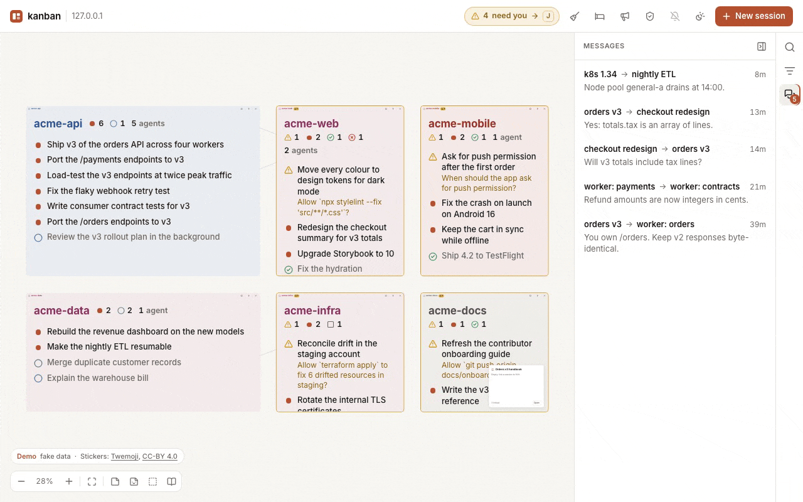
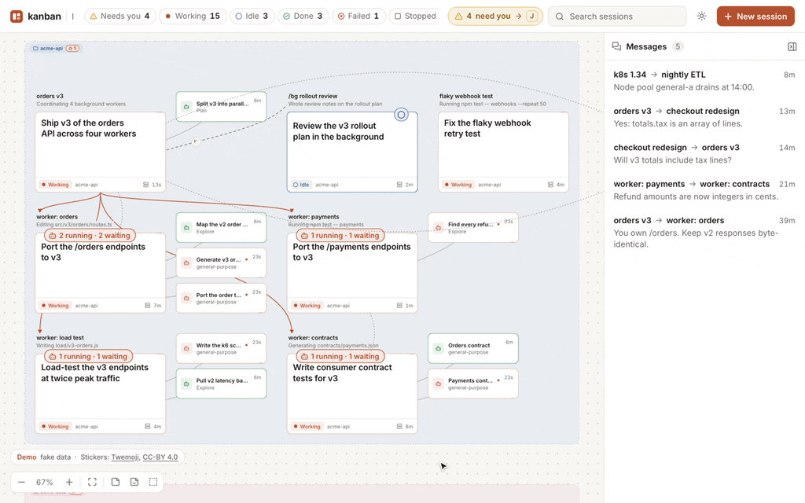
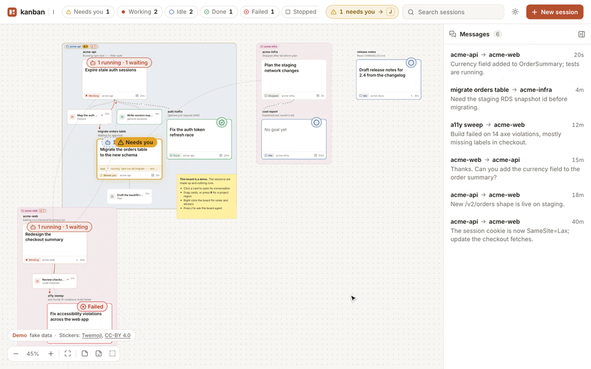
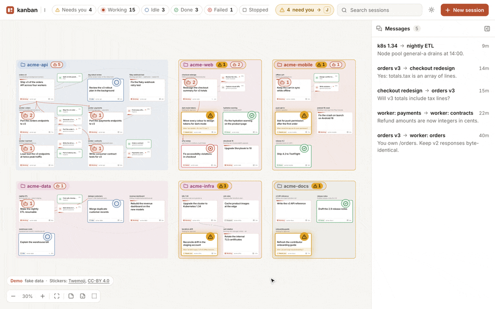
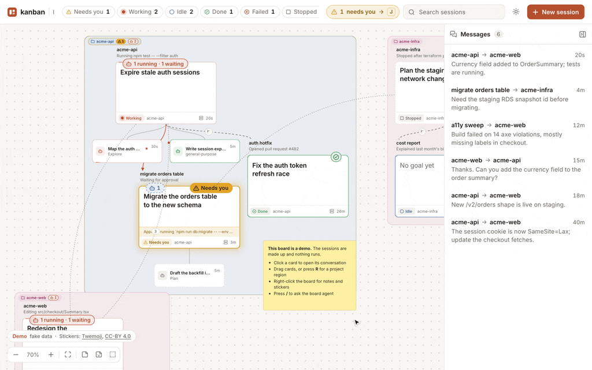
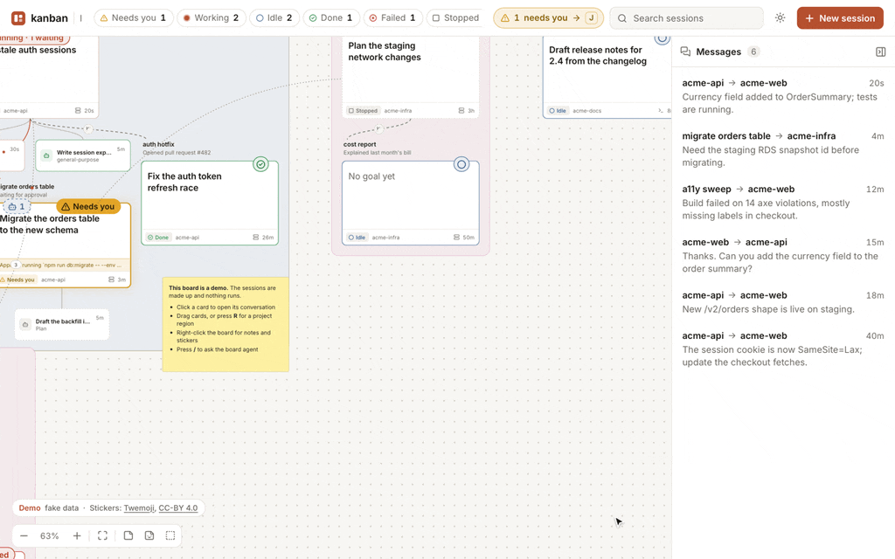

# kanban

A board of the Claude Code sessions running on one Mac. Each card is a live session with its goal and what it is doing; cards are linked when one session spawned or forked another or ran it as a subagent, and messages between sessions animate across the board. Click a card for its conversation, drawn natively from the transcript at any window size, with a composer, questions and permission prompts answered in place, and the real terminal one toggle away; or start a new one. Everything is read from `~/.claude`; there is no database.

<picture>
  <source media="(prefers-color-scheme: dark)" srcset="docs/media/headline-dark.gif">
  
</picture>

[Live demo](https://kranners.github.io/kanban/demo/?scenario=headline&play) · [Website](https://kranners.github.io/kanban/)

## Features

### A live board

Every session on the Mac is a card, whether kanban started it or not: background jobs, interactive sessions and sessions in cmux panes. A card shows its name, what it is doing, its goal in large type and one of seven states, each a colour and a shape: working, needs you, watching (its turn ended but subagents or background shells still run), idle, done, failed and stopped. Pan, zoom and pinch around the board: zoomed far out each project collapses into a scrolling summary of its sessions led by a short narrative of what they are doing together, and zoomed close a card adds a progress note that says what it is doing, how far along it is and whether it looks stuck, then its task list and latest steps; both show a timeline that projects when the tasks, and the project as a whole, should be done; light and dark follow the system, with a toggle, and the board installs as an app.

The narratives and progress notes are digests written by Haiku through your signed-in `claude`, only while a board page is open and only when a project's sessions have changed.

### Families and subagents

Arrowed links join a session to the sessions it spawned with `claude --bg`, the forks it made with `/bg` and its subagents. Subagents wrap into a compact grid under their session, a ribbon counts the ones still running or waiting, and the subagent pill in the top bar highlights the live ones.



### Messages

Messages sent between sessions animate along a dashed arc from sender to recipient. The messages rail lists them newest first; hovering one lights both cards and their arc.



### What needs you

Sessions waiting on you glow amber, and project frames count them. The top bar counts them too, and J pans to the next one, which Enter opens. The tab's title and icon carry the count, a banner names each session as it starts waiting, and the bell in the top bar turns on browser notifications for when the board isn't in front of you. Search matches name, project, directory and what a session is doing, and the activity pills filter by state; cards that don't match dim rather than vanish.



### Conversation view

Opening a card shows its conversation with the whole history: tool calls expand to their command and output, diff, checklist or answers, and a status bar shows model, branch, permission mode and tokens. Questions and permission prompts appear as native forms. The composer sends prompts, completes `/` commands and `@` files, interrupts with Esc and cycles the permission mode with Shift+Tab. Interactive sessions outside cmux and subagents open read-only.


### The real terminal

Terminal in the header switches to the session's own TUI: a full-window `claude attach` for a background session, or a live mirror of the pane for a session in [cmux](https://cmux.com), with buttons for the keys a dialog needs. Closing it leaves the session running.


### Start and exit sessions

New session takes a folder, an optional name and a first prompt, runs `claude --bg` and opens the card. Press A to start one in place with just a prompt, in the project under the pointer. Every folder chooser lists recent projects and ends with Choose folder…, which opens the macOS folder panel on the Mac running the board. A card's × asks the agent whether it is safe to exit first; hold Shift to force it.



### Organise the board

Drag cards anywhere on a snapping grid and resize them; the layout is saved and shared by every open board. Cards from one directory are framed in a project group, R adds a project region, and clicking a project label picks one of eight colours. N drops a sticky note in GitHub-flavoured markdown, with tickable checklists, and S places a Twemoji sticker.



### Ask the board

Press / anywhere and type a request, such as "organise my board into projects". A pin stays where you pressed, and its thread shows each action as it happens and the reply. The board agent is headless Claude Code with only the board's own tools: it can move cards, write notes, ask or prompt sessions and start or finish them, but it cannot run commands or read files.


### Keyboard

| Key  | Does                                   |
| ---- | -------------------------------------- |
| `J`  | Pan to the next session that needs you |
| `A`  | Start a session here with a prompt     |
| `/`  | Ask the board                          |
| `N`  | Add a note                             |
| `S`  | Add a sticker                          |
| `R`  | Add a project region                   |
| `⌘.` | Close the session view                 |

## Requirements

- macOS
- Node 24 or newer (runs the TypeScript directly)
- Claude Code on `PATH`, tested with 2.1.292
- [cmux](https://cmux.com), optional, only for mirroring and driving sessions in cmux panes

kanban reads Claude Code's on-disk state under `~/.claude` (the session registry, background jobs and transcripts). That format is undocumented and may change between Claude Code releases.

## Run locally

```sh
npm install
npm run build
KANBAN_AUTH=off npm start
```

Then open <http://127.0.0.1:7420>. `npm run dev` rebuilds and restarts on change; `npm run check` runs tsc, Biome and the tests. `npm run demo` serves a board of fictional sessions at <http://127.0.0.1:7421/demo/>, with no Claude Code needed.

## Configuration

| Variable           | Default                                        | Purpose                                                       |
| ------------------ | ---------------------------------------------- | ------------------------------------------------------------- |
| `KANBAN_AUTH`      | `access`                                       | Set `off` for local use; allowed only on a loopback host      |
| `KANBAN_HOST`      | `127.0.0.1`                                    | Bind address                                                  |
| `KANBAN_PORT`      | `7420`                                         | Port                                                          |
| `CLAUDE_BIN`       | first `claude` on `PATH`, skipping cmux's shim | The `claude` binary sessions are started and attached with    |
| `CMUX_BIN`         | cmux.app's bundled `cmux`                      | The `cmux` CLI that mirrors and drives sessions in cmux panes |
| `CLAUDE_HOME`      | `~/.claude`                                    | Claude Code's state directory                                 |
| `CSWAP_BIN`        | `cswap`                                        | The `cswap` CLI for several Claude accounts, when installed   |
| `KANBAN_STATE`     | `~/.local/state/kanban`, or `kanban-<port>`    | Where the layout, notes, colours, regions and threads live    |
| `KANBAN_AUDIT_LOG` | `~/Library/Logs/kanban/audit.jsonl`            | Audit log of exits, new sessions, sends and board agent edits |
| `KANBAN_DIST`      | `dist`                                         | Built page                                                    |

The default, `access`, verifies Cloudflare Access tokens and refuses to start without `KANBAN_ACCESS_TEAM` (the Access team name), `KANBAN_ACCESS_AUD` (the Access application's audience tag) and `KANBAN_ORIGIN` (the board's public origin, such as `https://kanban.example.com`); the [design notes](docs/design.md#infrastructure) describe the tunnel and Access setup. Run locally with `KANBAN_AUTH=off`.

## Security

kanban is a remote terminal into every background Claude Code session and every session in a cmux pane on the machine, so it is layered:
- The server binds to localhost; `KANBAN_AUTH=off` is refused on any other address.
- WebSocket upgrades must come from the board's own origin.
- Session keys, the daemon control key and other secrets under `~/.claude` are never read or served.
- The board agent behind / runs headless Claude Code with only the board's own tools, no shell or file access, and never force-exits; its tool endpoint takes a per-run token from loopback only, and every change it makes is audited.

See [SECURITY.md](SECURITY.md) for the threat model and how to report a vulnerability.

## Contributing

See [CONTRIBUTING.md](CONTRIBUTING.md). The [design notes](docs/design.md) cover where each piece of data comes from and how sessions are driven.

## License

Copyright (C) 2026 Aaron Pierce. kanban is licensed under the GNU Affero General Public License, version 3 only (`AGPL-3.0-only`); see [LICENSE](LICENSE).

Sticker graphics are from [Twemoji](https://github.com/jdecked/twemoji), Copyright 2019 Twitter, Inc and other contributors, licensed under [CC-BY 4.0](https://creativecommons.org/licenses/by/4.0/). They are vendored unmodified in `src/web/stickers/`, renamed from their codepoints.
