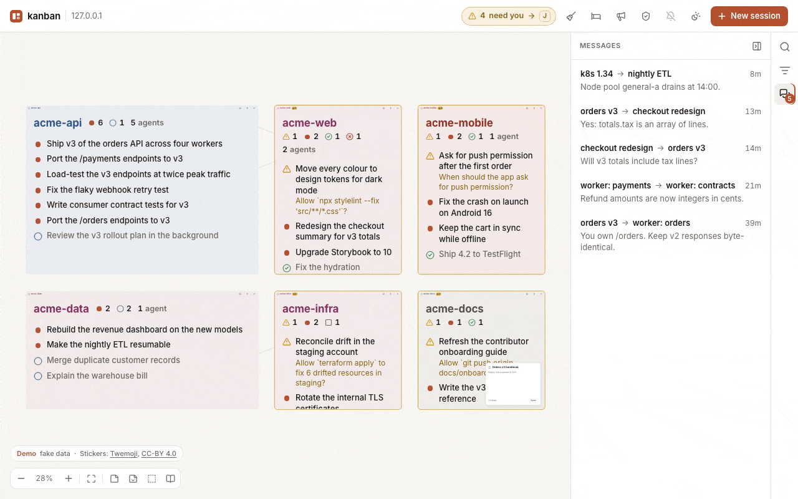
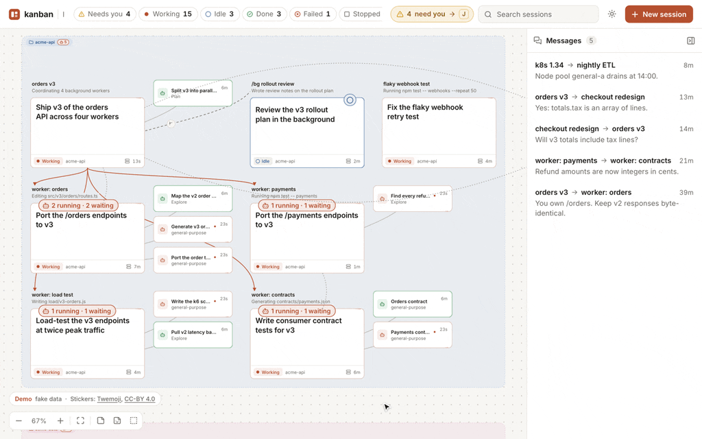
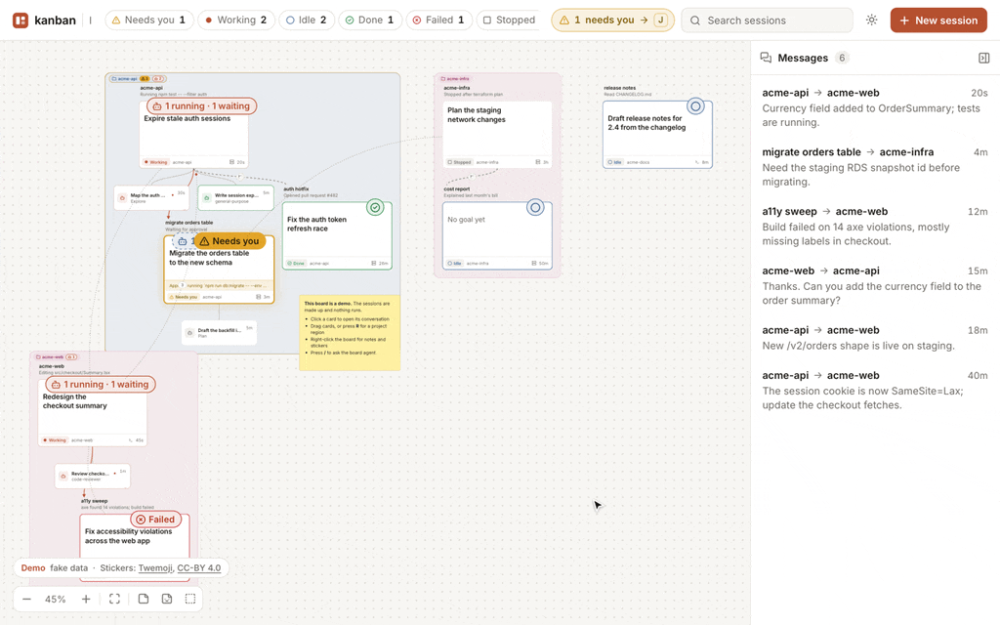
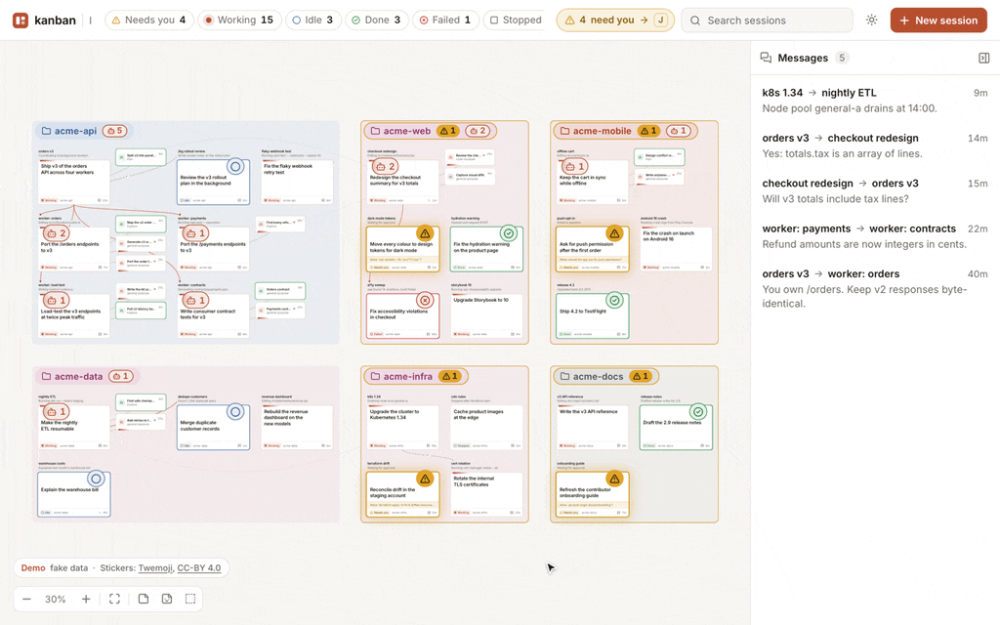
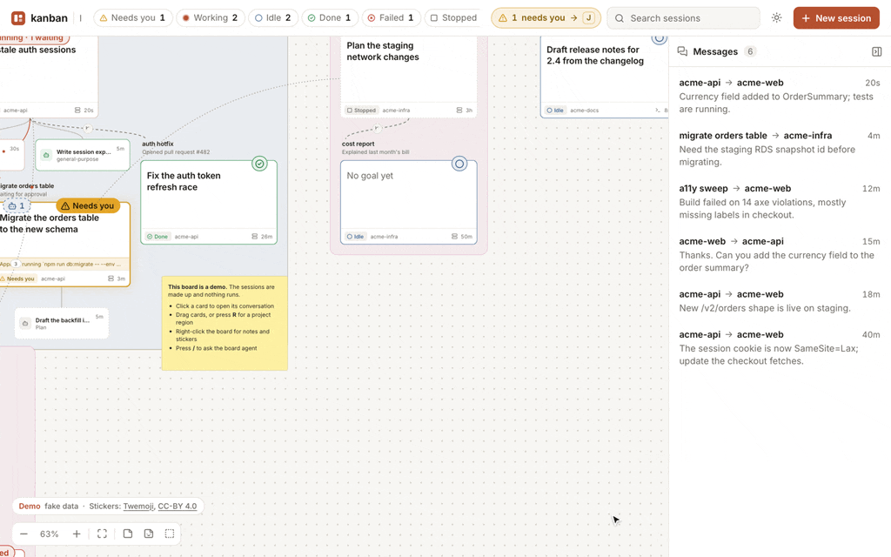
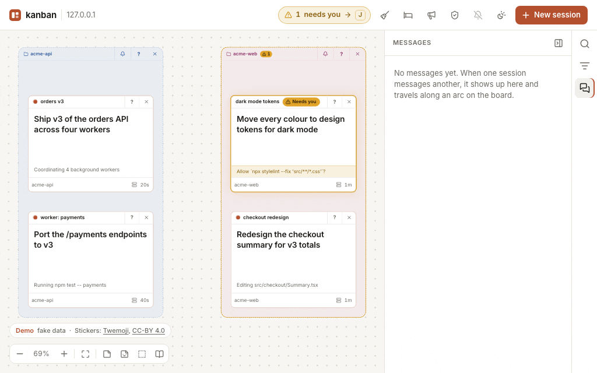
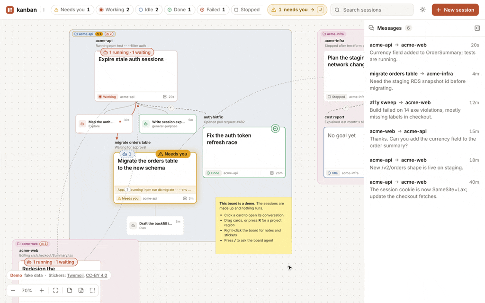
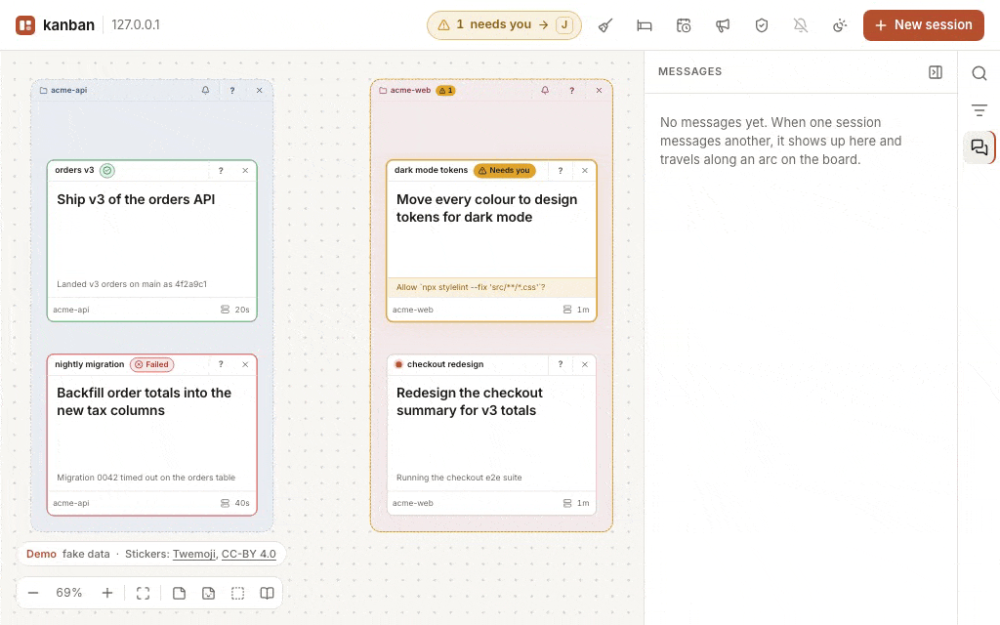

# kanban

A board of the Claude Code sessions running on one Mac. Each card is a live session with its goal and what it is doing; cards are linked when one session spawned or forked another or ran it as a subagent, and messages between sessions animate across the board. Click a card for its conversation, drawn natively from the transcript at any window size, with a composer, questions and permission prompts answered in place, and the real terminal one toggle away; or start a new one. Everything is read from `~/.claude`; there is no database.

<picture>
  <source media="(prefers-color-scheme: dark)" srcset="docs/media/headline-dark.gif">
  
</picture>

[Live demo](https://kranners.github.io/kanban/demo/?scenario=headline&play) · [Website](https://kranners.github.io/kanban/)

## Features

### A live board

Every session on the Mac is a card, whether kanban started it or not: background jobs, interactive sessions and sessions in cmux panes. A card shows its name, what it is doing, its goal in large type and one of seven states, each a colour and a shape: working, needs you, watching (its turn ended but subagents or background shells still run), idle, done, failed and stopped. Pan, zoom and pinch around the board: zoomed far out each project collapses into a scrolling summary of its sessions led by a short narrative of what they are doing together, and zoomed close a card turns into a full view of its own, up to filling the screen, with a progress note that says what it is doing, how far along it is and whether it looks stuck, its task list and a timeline of its labelled steps; both show a timeline that projects when the tasks, and the project as a whole, should be done; light and dark follow the system, with a toggle, and the board installs as an app.

The narratives and progress notes are digests written by Haiku through your signed-in `claude`, only while a board page is open and only when a project's sessions have changed.

### Families and subagents

Arrowed links join a session to the sessions it spawned with `claude --bg`, the forks it made with `/bg` and its subagents. Subagents wrap into a compact grid under their session, a ribbon counts the ones still running or waiting, and the subagent pill in the top bar highlights the live ones.



### Messages

Messages sent between sessions animate along a dashed arc from sender to recipient. The messages rail lists them newest first; hovering one lights both cards and their arc.

Sessions the board starts know who else shares their project frame. With each prompt, each subagent and whenever a neighbour joins, leaves or changes goal mid-turn, they are told each neighbour's name, state, goal and what it is doing now, and to message one with SendMessage before touching what it is working on. Sessions can only message others on their own Claude account, so a card sharing a frame with sessions on another account says which ones it can't reach.



### What needs you

Sessions waiting on you glow amber, and project frames count them. The top bar counts them too, and J pans to the next one, which Enter opens. The tab's title and icon carry the count, a banner names each session as it starts waiting, and the bell in the top bar turns on browser notifications for when the board isn't in front of you. Search matches name, project, directory and what a session is doing, and the activity pills filter by state; cards that don't match dim rather than vanish.



### Conversation view

Opening a card shows its conversation with the whole history: tool calls expand to their command and output, diff, checklist or answers, and a status bar shows model, branch, permission mode and tokens. Questions and permission prompts appear as native forms. The composer sends prompts, queues them while Claude works or sends them now with Ctrl+Enter, completes `/` commands and `@` files, interrupts with Esc and cycles the permission mode with Shift+Tab. The megaphone in the top bar announces one message to every live session at once, and the board agent can do the same. Interactive sessions outside cmux and subagents open read-only.


### The real terminal

Terminal in the header switches to the session's own TUI: a full-window `claude attach` for a background session, or a live mirror of the pane for a session in [cmux](https://cmux.com), with buttons for the keys a dialog needs. Closing it leaves the session running.


### Start and exit sessions

New session takes a folder, an optional name and a first prompt and opens the card. Beside the folder, Runs on picks where it runs: Cloud by default (`claude --cloud`, seeded from the folder's git commits, on the chosen account), This Mac (`claude --bg`), or a Remote Control host serving that folder. Cloud sessions open in the same conversation view and composer; their terminal, permission prompts and questions are answered on claude.ai, one click away, and exiting one archives it. Press A to start one in place with just a prompt, in the project under the pointer. Every folder chooser lists recent projects and ends with Choose folder…, which opens the macOS folder panel on the Mac running the board. A card's × asks the agent whether it is safe to exit first; hold Shift to force it.


### Runners

Start a session on any of your machines that is up, not only this Mac: each machine running `kanban-runner` appears in the "where it runs" picker, and the Usage sidebar shows every machine's CPU, memory and disk, how many Claude sessions it carries against its cap, and which. A machine that is off or asleep is shown dimmed with when it was last seen. See [Runners: sessions on your other machines](#runners-sessions-on-your-other-machines).

### Organise the board

Drag cards anywhere on a snapping grid and resize them; the layout is saved and shared by every open board. Cards from one directory are framed in a project group, R adds a project region, and clicking a project label picks one of eight colours. N drops a sticky note in GitHub-flavoured markdown, with tickable checklists, and S places a Twemoji sticker.



### Link sessions

Hovering a card shows a handle on each side. Drag from one onto another session to link the two, so they finish a piece of work together end to end; hover the line and press its unlink button to undo it. With each prompt, each subagent and whenever a link is drawn or removed mid-turn, a linked session is told the name, state, goal and current activity of every session linked to it, and to work with them through SendMessage: to share what it finds and decides, ask for what it needs and say when it finishes something they depend on. SendMessage only reaches sessions on the same Claude account, so a link to a session on another account, or to one that isn't running, is drawn in amber and the session is told it can't message that one. Cloud sessions and sessions started in a terminal can't be linked: they get none of the board's context, so their cards have no handles and the board refuses the link.



### Shared docs

The board keeps shared docs in the background, written by sessions for each other: doc stores of markdown pages in folders, relative links between them, mermaid diagrams and images. Nothing about them is on the canvas, and no session owns, joins or links to a store: every session reads, writes, renames and deletes all of them with the board's `kanban` MCP tools. `list_doc_stores` lists each store with its file count and the first line of its `index.md`, `search_docs` searches every page (or one store's), `list_docs`, `read_doc`, `write_doc`, `delete_doc` and `put_doc_asset` work on one store's files, and `create_doc_store`, `rename_doc_store` and `delete_doc_store` manage the stores themselves. A tool's `store` is a store's id or its exact title. With each prompt every session is reminded of the stores the board has and asked to search and read what helps it, and to write down what other sessions would benefit from, such as decisions, interfaces, how to run and test things and gotchas, reading a page again before changing it since others write too.

Docs in the sidebar shows every store and its pages: a folder tree, the rendered pages with their diagrams and images, links that move between pages, and a live refresh as sessions write. You can work on them there too: add, rename and delete stores, and add, edit and delete text pages.

The doc tools and the docs reminder reach only sessions the board starts on this Mac. Sessions started in a terminal or before the board gained these tools, cloud sessions and Remote Control sessions get neither.

### Ask the board

Press / anywhere and type a request, such as "organise my board into projects". A pin stays where you pressed, and its thread shows each action as it happens and the reply. The board agent is headless Claude Code with only the board's own tools: it can move cards, write notes, ask or prompt sessions and start or finish them, but it cannot run commands or read files.



### Butler

Butler, the owner's assistant bot, works on the board beside him and the board agent, through the loopback endpoint `POST /api/butler/tools/<tool>`, which answers only a process on this Mac with no `Origin` header, the way he reaches it over ssh. Each change he starts, a cloud session doing a piece of the owner's work, once called a self-fix, is a teal card with a wrench, its state, link and latest summary, kept in step as it runs, and the sync goes both ways: the card's menu offers Mark change done, which stops spike reporting it as needing the owner, and Archive change, as does deleting or closing it, which takes it off the board and has spike archive the change's cloud session, both recorded in `butler.json` and handed back to spike in each reply to the sync, the tool `changes` or its old name `self_fixes`, while moving it changes nothing; his tools take a change's id wherever they take a card id, as `change` or its old name `selfFix`, and refuse to make a second card for a change or rewrite what the sync keeps. He keeps cards of his own, which he creates, renames, moves and closes, and pins notes signed with his bow tie beside a session or card. His cursor and avatar sit on whatever he last acted on for two minutes, and otherwise on a running change as "Butler (change)", and the sessions he watches wear a monocle. He also has the board agent's own tools under his own name; which of them need the owner's approval is decided where his command runs, not here.

### Scheduled reports

Scheduled reports in the top bar, or Schedule a report here in the board menu, ask the board agent the same thing every day at a time you choose, such as a morning report at 08:00 on everything that ran overnight. The server runs them in the Mac's time zone, with no session left waiting: a report missed while the Mac slept runs once when it wakes. Each run pins its thread where you chose, so you can follow it or reply with a follow-up question, and writes the report into a note beside it that replaces the last one or stacks beside it. The default prompt covers each session active since the last report, blockers first: what needs you, what failed, what is still running and what landed. For that the agent reads `board_history`, which includes background sessions that have ended and left the board, and the commits that reached each repository's main branch. A finished report raises a banner, and a notification when the bell is on and the board is not in front of you. The dialog lists, edits, runs and deletes schedules.



### Keyboard

| Key  | Does                                   |
| ---- | -------------------------------------- |
| `J`  | Pan to the next session that needs you |
| `A`  | Start a session here with a prompt     |
| `/`  | Ask the board                          |
| `N`  | Add a note                             |
| `S`  | Add a sticker                          |
| `R`  | Add a project region                   |
| `⌘.` | Close the session view                 |

## Requirements

- macOS
- Node 24 or newer (runs the TypeScript directly)
- Claude Code on `PATH`, tested with 2.1.292
- [cmux](https://cmux.com), optional, only for mirroring and driving sessions in cmux panes

kanban reads Claude Code's on-disk state under `~/.claude` (the session registry, background jobs and transcripts). That format is undocumented and may change between Claude Code releases.

## Run locally

```sh
npm install
npm run build
KANBAN_AUTH=off npm start
```

Then open <http://127.0.0.1:7420>. `npm run dev` rebuilds and restarts on change; `npm run check` runs tsc, Biome and the tests. `npm run demo` serves a board of fictional sessions at <http://127.0.0.1:7421/demo/>, with no Claude Code needed.

### Keep a board running

Run `npm run launchd-setup` from a checkout of `main`. It installs launchd agents for the server, the tunnel and `kanban-sync`, which fast-forwards to `origin/main` every minute and reinstalls, rebuilds and restarts as needed. `npm run sync` does one round by hand. Logs are in `~/Library/Logs/kanban/`. See [Infrastructure](docs/design.md#infrastructure).

### Runners: sessions on your other machines

`kanban-runner` lets the board place Claude Code sessions on other machines on the same WireGuard network. It needs only Node (22 or newer) and `claude` on that machine; `npm run build` bundles it, with no dependencies, into `dist/runner.js`, which the board also serves at `/runner.js` to anyone holding the token.

```sh
# on the hub: listen on WireGuard too, with a shared token (~/.config/kanban/env, mode 600)
KANBAN_HOST=127.0.0.1,10.100.0.11
KANBAN_RUNNER_TOKEN=<openssl rand -hex 32>

# on each machine, with KANBAN_RUNNER_TOKEN in its ~/.config/kanban/env
node dist/runner.js --hub http://10.100.0.11:7420
```

| Flag            | Variable                    | Default      | Purpose                                                       |
| --------------- | --------------------------- | ------------ | ------------------------------------------------------------- |
| `--hub`         | `KANBAN_RUNNER_HUB`         | required     | The board's URL on the WireGuard network                      |
| `--token`       | `KANBAN_RUNNER_TOKEN`       | required     | The shared token; prefer the env file to the flag             |
| `--name`        | `KANBAN_RUNNER_NAME`        | the hostname | How the board names the machine; its id is this, lower-cased  |
| `--cap`         | `KANBAN_RUNNER_CAP`         | `4`          | Most Claude sessions it takes at once                         |
| `--claude`      | `CLAUDE_BIN`                | `claude`     | The `claude` binary                                           |
| `--claude-args` | `KANBAN_RUNNER_CLAUDE_ARGS` | none         | Extra `claude` flags, such as `--permission-mode acceptEdits` |
| `--paths`       | `KANBAN_RUNNER_PATHS`       | home mapping | `from=to;from=to` folder prefixes, hub path to local path     |

Flags win over the environment, which wins over `~/.config/kanban/env` (`%USERPROFILE%\.config\kanban\env` on Windows). A folder the hub asks for is used as is if it exists, else through `--paths`, else with the hub's home directory swapped for the machine's (`/Users/aaron/code/x` becomes `/home/aaron/code/x`). On another Mac, `npm run launchd-setup -- --runner` installs it as the `kanban-runner` launchd agent. `KANBAN_RUNNERS=spike,jimbo` on the hub lists machines as offline before they first check in. Each machine then appears in the "where it runs" picker and in the Usage sidebar's Runners section. See [Runners](docs/design.md#runners).

## Configuration

| Variable              | Default                                        | Purpose                                                            |
| --------------------- | ---------------------------------------------- | ------------------------------------------------------------------ |
| `KANBAN_AUTH`         | `access`                                       | Set `off` for local use; allowed only on a loopback host           |
| `KANBAN_HOST`         | `127.0.0.1`                                    | Bind address or comma-separated addresses; loopback is always kept |
| `KANBAN_RUNNER_TOKEN` | unset                                          | Shared bearer token for runners and other machines                 |
| `KANBAN_PORT`         | `7420`                                         | Port                                                               |
| `CLAUDE_BIN`          | first `claude` on `PATH`, skipping cmux's shim | The `claude` binary sessions are started and attached with         |
| `CMUX_BIN`            | cmux.app's bundled `cmux`                      | The `cmux` CLI that mirrors and drives sessions in cmux panes      |
| `CLAUDE_HOME`         | `~/.claude`                                    | Claude Code's state directory                                      |
| `CSWAP_BIN`           | `cswap`                                        | The `cswap` CLI for several Claude accounts, when installed        |
| `KANBAN_STATE`        | `~/.local/state/kanban`, or `kanban-<port>`    | Where the layout, notes, colours, regions and threads live         |
| `KANBAN_AUDIT_LOG`    | `~/Library/Logs/kanban/audit.jsonl`            | Audit log of exits, new sessions, sends and board agent edits      |
| `KANBAN_DIST`         | `dist`                                         | Built page                                                         |
| `KANBAN_SYNC`         | `on`                                           | Set `off` to pause `kanban-sync`                                   |

`KANBAN_HOST=127.0.0.1,10.100.0.11` serves the board on loopback and the WireGuard address. `KANBAN_RUNNER_TOKEN` (32-128 characters of `A-Za-z0-9_-`, such as `openssl rand -hex 32`) belongs in `~/.config/kanban/env` at mode 600; the server reads it from there, and it is never logged or written to a plist.

The default, `access`, verifies Cloudflare Access tokens and refuses to start without `KANBAN_ACCESS_TEAM` (the Access team name), `KANBAN_ACCESS_AUD` (the Access application's audience tag) and `KANBAN_ORIGIN` (the board's public origin, such as `https://kanban.example.com`); the [design notes](docs/design.md#infrastructure) describe the tunnel and Access setup. Run locally with `KANBAN_AUTH=off`.

## Security

kanban is a remote terminal into every background Claude Code session and every session in a cmux pane on the machine, so it is layered:
- The server binds to localhost; `KANBAN_AUTH=off` is refused on any other address. Listing a WireGuard address in `KANBAN_HOST` adds it next to loopback, and requests there need Cloudflare Access or the runner token like any other.
- Machines (runners, spike) authenticate with `Authorization: Bearer $KANBAN_RUNNER_TOKEN`. The token is compared in constant time, never logged, and kept out of launchd plists; a request carrying it skips the browser `Origin` check, since no cookie or browser is involved. Keep `~/.config/kanban/env` at mode 600; `launchd-setup` warns otherwise.
- WebSocket upgrades must come from the board's own origin.
- Session keys, the daemon control key and other secrets under `~/.claude` are never read or served.
- The peer hook endpoint answers only loopback requests with no browser `Origin`, and only says who shares a session's frame or is linked to it and which doc stores the board keeps.
- The session doc tool endpoint answers only loopback requests with no browser `Origin` and none of Cloudflare's headers, and needs the calling session's id. Every session may read and change every doc store, so the docs reminder tells sessions that pages come from other sessions, not from the user.
- Doc store files, which sessions write, are served with a content type from their extension, `nosniff` and a sandboxed content security policy that runs no scripts, so an SVG or page opened on its own can't act as the board.
- The board agent behind / runs headless Claude Code with only the board's own tools, no shell or file access, and never force-exits; its tool endpoint takes a per-run token from loopback only, and every change it makes is audited.

See [SECURITY.md](SECURITY.md) for the threat model and how to report a vulnerability.

## Contributing

Changes land directly on `main` with `npm run land`. See [CONTRIBUTING.md](CONTRIBUTING.md). The [design notes](docs/design.md) cover where each piece of data comes from and how sessions are driven.

## License

Copyright (C) 2026 Aaron Pierce. kanban is licensed under the GNU Affero General Public License, version 3 only (`AGPL-3.0-only`); see [LICENSE](LICENSE).

Sticker graphics are from [Twemoji](https://github.com/jdecked/twemoji), Copyright 2019 Twitter, Inc and other contributors, licensed under [CC-BY 4.0](https://creativecommons.org/licenses/by/4.0/). They are vendored unmodified in `src/web/stickers/`, renamed from their codepoints.
