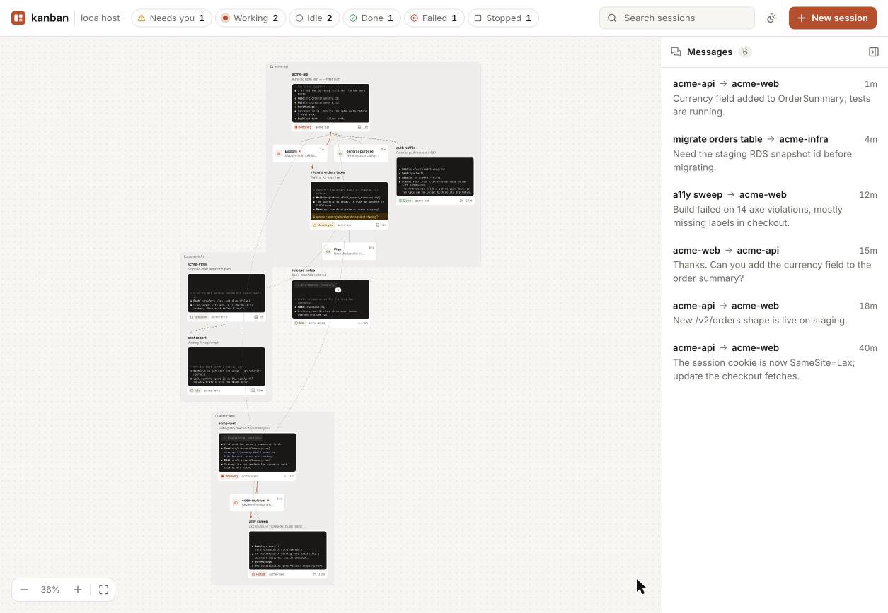

# kanban

A board of the Claude Code sessions running on one Mac. Each card is a live session with its goal and what it is doing; cards are linked when one session spawned, forked or delegated to another, and messages between sessions animate across the board. Click a card for its conversation, drawn natively from the transcript at any window size, with a composer, questions and permission prompts answered in place, and the real terminal one toggle away; or start a new one. Everything is read from `~/.claude`; there is no database.

<picture>
  <source media="(prefers-color-scheme: dark)" srcset="docs/board-dark.png">
  
</picture>

## Requirements

- macOS with Claude Code at `/opt/homebrew/bin/claude`
- Node 24 or newer (runs the TypeScript directly)

## Run locally

```sh
npm install
npm run build
KANBAN_AUTH=off npm start
```

Then open <http://127.0.0.1:7420>. `npm run dev` rebuilds and restarts on change; `npm run check` runs tsc, Biome and the tests.

## Configuration

| Variable             | Default                    | Purpose                                                                  |
| -------------------- | -------------------------- | ------------------------------------------------------------------------ |
| `KANBAN_AUTH`        | `access`                   | `access` verifies Cloudflare Access; `off` only on a loopback host       |
| `KANBAN_ACCESS_TEAM` |                            | Access team name, required with `access`                                 |
| `KANBAN_ACCESS_AUD`  |                            | Access application audience tag, required with `access`                  |
| `KANBAN_ORIGIN`      |                            | Public origin, e.g. `https://kanban.example.com`; required with `access` |
| `KANBAN_HOST`        | `127.0.0.1`                | Bind address                                                             |
| `KANBAN_PORT`        | `7420`                     | Port                                                                     |
| `CLAUDE_BIN`         | `/opt/homebrew/bin/claude` | The `claude` binary sessions are started and attached with               |
| `CMUX_BIN`           | cmux.app's bundled `cmux`  | The `cmux` CLI that mirrors and drives sessions in cmux panes            |
| `CLAUDE_HOME`        | `~/.claude`                | Claude Code's state directory                                            |
| `KANBAN_DIST`        | `dist`                     | Built page                                                               |

## Deployment

The board is reached through a Cloudflare Tunnel and gated by Cloudflare Access.
1. Create a Cloudflare API token with Account: Cloudflare Tunnel Edit, Account: Access: Apps and Policies Edit, Zone: Zone Read and Zone: DNS Edit, and save it to `~/.cloudflared/api-token`.
2. Run `KANBAN_ALLOWED_EMAIL=you@example.com node scripts/cloudflare-setup.ts` (`--dry-run` only reads; `--account`, `--zone`, `--hostname`, `--team`, `--service` and `--tunnel-name` override the defaults). It is idempotent: it finds or creates the remotely managed tunnel, the Access application with one Allow policy for that email, the tunnel's ingress, and finally the proxied DNS record, so the hostname is never reachable without Access. It writes `~/.config/kanban/env` and `~/.config/kanban/tunnel-token`, both mode 600.
3. Two launchd user agents, declared in the host's nix config, run the server (sourcing `~/.config/kanban/env`) and `cloudflared tunnel run --token-file ~/.config/kanban/tunnel-token`, logging to `~/Library/Logs/kanban/`.

## Security

kanban is a remote terminal into every background Claude Code session and every session in a cmux pane on the machine, so it is layered:
- Cloudflare Access admits one identity; cloudflared itself rejects requests without a valid Access token.
- The server verifies `Cf-Access-Jwt-Assertion` against the team's signing keys and the application audience.
- WebSocket upgrades must come from the board's own origin.
- The server binds to localhost; `KANBAN_AUTH=off` is refused on any other address.
- Session keys, the daemon control key and other secrets under `~/.claude` are never read or served.
- The board agent behind / runs headless Claude Code with only the board's own tools, no shell or file access, and never force-exits; its tool endpoint takes a per-run token from loopback only, and every change it makes is audited.

## Credits

Sticker graphics are from [Twemoji](https://github.com/jdecked/twemoji), Copyright 2019 Twitter, Inc and other contributors, licensed under [CC-BY 4.0](https://creativecommons.org/licenses/by/4.0/). They are vendored unmodified in `src/web/stickers/`, renamed from their codepoints.

## Further reading

- [Design](docs/design.md)
- [Roadmap](docs/roadmap.md)
